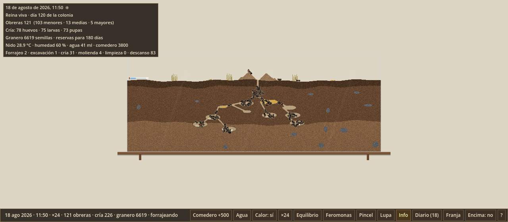
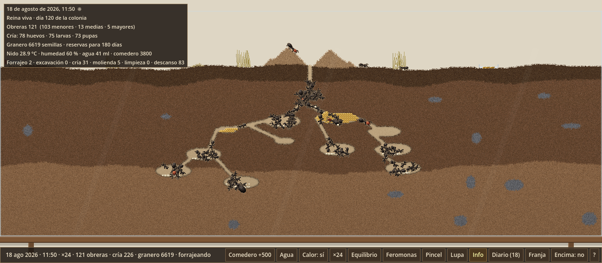
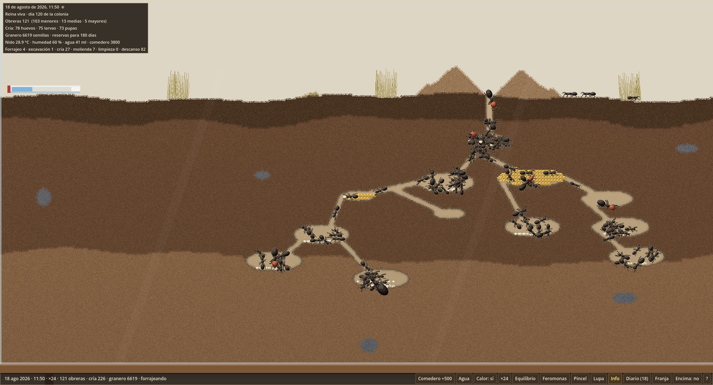
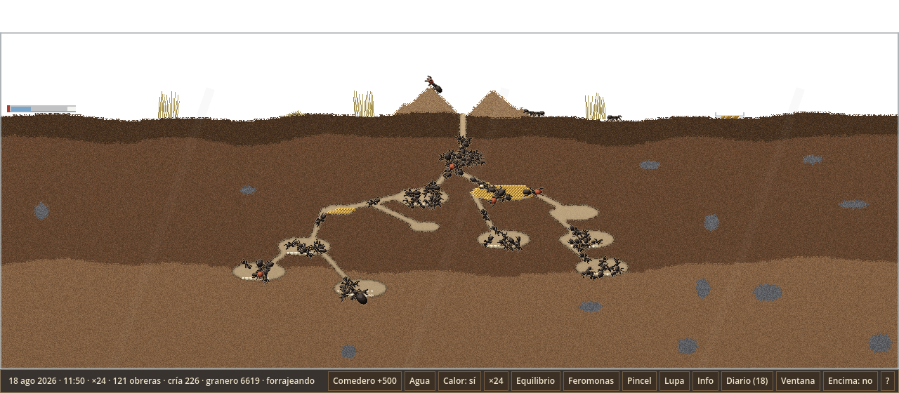

# ADR-005 · Fase 2 — Integración en el juego

- **Fecha:** 2026-10-13 · rama `adr-005-detalle-zoom`
- **Alcance:** detalle por niveles dentro de la escena principal, detrás de un interruptor **apagado por defecto**. `sim/` no se ha tocado y el formato de guardado no cambia.

## Cómo se activa

| Vía | Efecto |
|---|---|
| Tecla **D** | Enciende o apaga el detalle; reconstruye solo las capas del mundo |
| `settings.cfg` → `[detalle] niveles=true` | Valor guardado (`GameSettings.detail_levels_enabled`); va en los ajustes, no en la partida |
| `--detalle` / `--sin-detalle` | Forzarlo desde la línea de órdenes |
| `--zoom=N` | Fija el zoom (en modo detalle se ajusta a 1, 2 o 4) y desactiva el automático |
| `--captura-fija` | Congela el tiempo (`Engine.time_scale = 0`) y salta el offline, para obtener capturas reproducibles |

Con el detalle encendido, el zoom automático elige el **mayor paso de {1, 2, 4} que cabe en la ventana**. `+`/`−` y la rueda avanzan de paso en paso.

## Cómo funciona

- **Sin escalar nada:** en modo detalle `world_root.scale = 1` y cada capa dibuja directamente a resolución de pantalla (1 texel = 1 píxel). La interfaz conserva su propia escala.
- **Suelo** (`game/lod/soil_lod_view.gd` + `game/shaders/soil_lod.gdshader`):
  - el shader de la Fase 1, ahora **cacheado en un SubViewport**: solo se vuelve a renderizar al cambiar de zoom o cuando cambia el suelo;
  - `SoilRenderer` emite `redrawn(rects)` con los rectángulos que ha repintado, y la vista repinta solo esos parches (con 3 celdas de margen, `blend_disabled` y `CLEAR_MODE_NEVER`);
  - a ×1 copia la textura actual con `texelFetch`, sin ninguna diferencia.
- **Hormigas** (`game/lod/ant_lod_renderer.gd`, `ant_view_state.gd`, `game/shaders/ant_lod.gdshader`):
  - un `MultiMesh` por variante (menor, media, mayor, reina, nanitic) con el atlas del nivel activo, más otro para lo que llevan en las mandíbulas;
  - la posición se ajusta al **píxel entero**;
  - descarte de las que quedan fuera de la vista.
- **Suelo o cristal (decisión del propietario):** dentro del nido, cuando una hormiga tiene suelo bajo los pies y avanza en horizontal, **elige** ir por el suelo (de perfil, con los pies apoyados) o por el cristal (cenital). Por defecto, 60 % suelo y 40 % cristal (`GLASS_CHOICE`).
  - La elección se renueva en cada tramo, es decir, al arrancar o al dar la vuelta.
  - Sale de un hash del índice y del tramo, así que no usa ninguna RNG.
  - Sin suelo debajo, o en vertical, va por el cristal. En la superficie, siempre de perfil.
  - El cambio de vista tiene 0,3 s de histéresis.
- **Resto de capas:**
  - **Objetos** (semillas, cría, terrones…): atlas nuevo por nivel en `assets/items_lod/`. L0 es copia exacta del actual; L1 y L2 se dibujan con más resolución (`tools/gen_items_lod.py`).
  - **Feromonas:** moteado por hash a ×2 y ×4 (`pheromone_lod.gdshader`).
  - **Hierba:** briznas de 1 px a cualquier zoom.
  - **Decorado plano:** se dibuja con `draw_set_transform`.
- **Exportación:** se añaden al filtro los manifiestos JSON y `data/palette.json`. Los PNG se cargan con `load()`, como recursos importados (sin pérdida y sin mipmaps), así que funcionan igual en el editor y en el ejecutable.

## Criterios comprobados

| Criterio | Resultado |
|---|---|
| Interruptor apagado = juego de hoy | Capturas **idénticas bit a bit** a las de `main` en ventana, ventana grande y franja ✅ |
| ×1 con el detalle encendido | Suelo, decorado y objetos idénticos; solo cambian las hormigas, que ya llevan el atlas animado (**0,78 %** de los píxeles) ✅ |
| 1 texel = 1 píxel | Comprobado con el tablero de depuración a ×1, ×2 y ×4 ✅ |
| Caché parcial del suelo | `tools/check_soil_cache.gd` compara la caché parcheada con un repintado completo tras excavar: **0 píxeles distintos** a ×1, ×2 y ×4 ✅ |
| Determinismo | `test_view_state_does_not_touch_sim`: `state_hash` y las tres RNG iguales con y sin la vista. La captura congelada da el mismo hash en dos ejecuciones ✅ |
| Guardados | Sin cambios de formato ni de `SAVE_VERSION` ✅ |
| Rendimiento (≤ +10 %) | Entre −5 % y +4 % frente al detalle apagado, dentro del ruido (render por software). El suelo ya no cuesta nada por fotograma ✅ |
| Ejecutable | La build de Linux exportada arranca con `--detalle` y carga los atlas sin errores ✅ |
| Tests | **24 en verde**, 7 de ellos nuevos en `tests/test_lod_view.gd` ✅ |

## Capturas

| ×1 | ×2 |
|---|---|
|  |  |

| ×4 (1920×1040) | Franja |
|---|---|
|  |  |

## Riesgos y pendientes

1. **El arte de las hormigas es provisional**: sale del modelo de elipsoides de la Fase 1. Es lo que toca en la Fase 3.
2. **Apelotonamiento visual:** con la base de 9 px a ×2 y ×4, las cámaras llenas se ven como una masa oscura. Se puede suavizar en la Fase 3 con contornos más claros o variando el tono por casta.
3. **Lupa:** sigue sin adaptarse al modo detalle (cuestión abierta 1).
4. **Memoria:** unos 29 MiB de atlas, aceptado por el propietario.
5. **Rendimiento de la simulación** (no del ADR): con 1.200 hormigas, el tick cuesta 12,4 ms. El plan B sigue siendo GDExtension.

## Propuestas para la Fase 3 (arte definitivo)

- Afinar el modelo (proporciones de *M. barbarus*: cabeza grande en la mayor, peciolo y pospeciolo, antenas acodadas) o sustituirlo por arte a mano con el mismo contrato de atlas.
- `idle_frames` opcionales en el manifiesto, para recuperar el tanteo de antenas en reposo.
- «Piedrecitas» de 2–3 subceldas en el suelo a ×4.
- Revisar el tono del contorno para separar hormigas cuando hay muchas juntas.
- Con el visto bueno: aplicar al GDD y al ROADMAP los cambios que propone el ADR, cambiar el estado del ADR a «aceptado» y fusionar con `main`.
